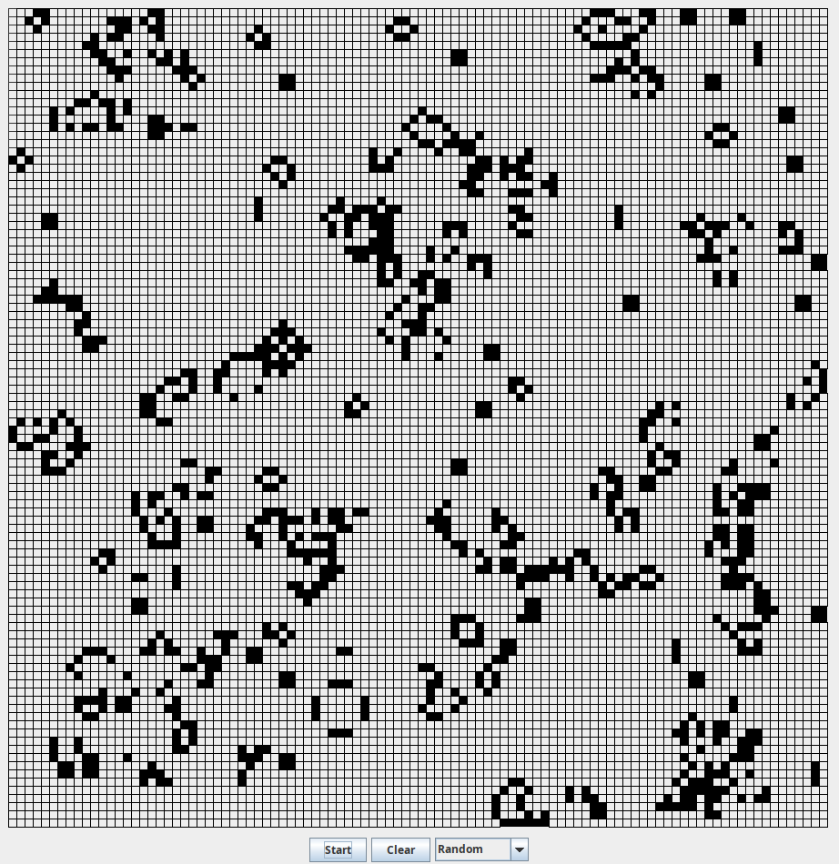

# GameOfLife
Simples Conway's Game Of Life in Java

## GameOfLife.java
In *GameOfLife.java* wird das Spielfeld als 2-dimenionales boolean-Array angelegt.  
In der Methode *boolean check(int y, int x)* werden für eine gegebenen Koordinate die Nachbarfelder überprüft und es wird entschieden, ob die übergebene Zelle überlebt, stirbt oder lebendig wird.  
Die Methode *void step()* wertet das gesamte Spielfeld aus und aktualisiert dieses.  
Für eine Simulation in der Konsole kann *void loop()* bzw. *void loop(int n)* verwendet werden, die das Spielfeld in der Konsole ausgeben und unendlich oder bis zu einem Simulationsschritt n laufen lassen.

## Window.java
In *Window.java* wird mit *javax.swing* ein Fenster erstellt, indem das Programm angezeigt wird.  
Auf einem Raster wird das Spiel angezeigt, das man starten und löschen kann. Unten kann man einige voreingestellt Muster auswähln.  
 
Hier werden zudem die Mausinteraktionen geregelt, mit denen man auf dem Raster selber zeichnen kann. 
